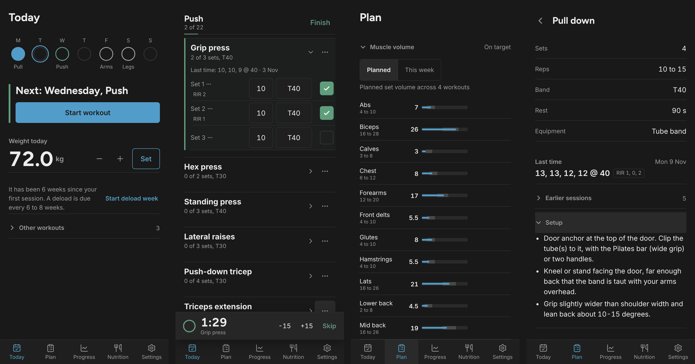
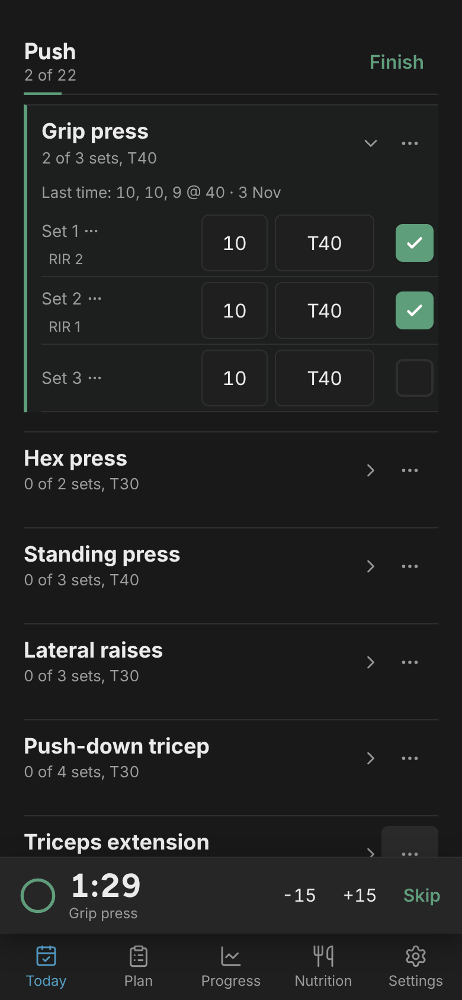
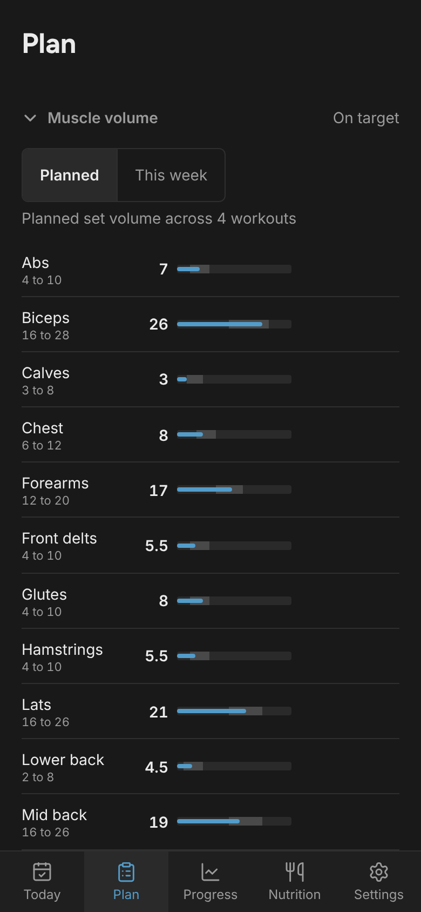
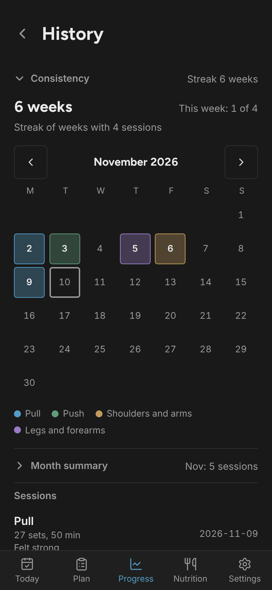
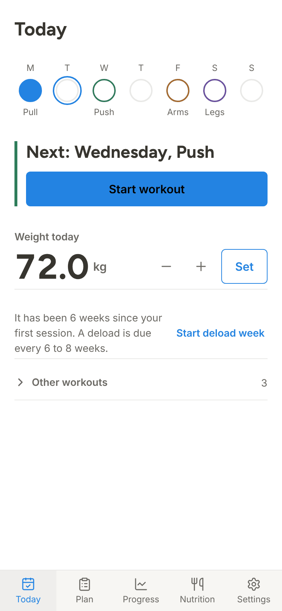

# Loop Fitness

An offline-first workout tracker for training at home with resistance bands. It is a single-user Progressive Web App: install it on your phone, log every set mid-workout, and let it tell you when to move to the next band.

**Live app:** [loop-fitness.pages.dev](https://loop-fitness.pages.dev) (sync and reminders need the owner's passphrase; everything else works locally)



## Why

Gym trackers think in kilograms. Bands don't: they come in discrete levels (a 30 lb tube, a 15–50 lb loop, two tubes stacked), and resistance rises as they stretch. Loop Fitness treats bands as a first-class unit, builds a resistance ladder from the bands you own, and bases progression on that ladder instead of on weight.

## Features

**Training**
- A 4-day arms and back specialization program (pull, push, shoulders and arms, legs and forearms) with per-muscle weekly volume targets, defined in [`app/public/plan.json`](app/public/plan.json) and documented in [`content/`](content/).
- Fast logging: one line per set (reps, band, check), reps in reserve (RIR) in one tap, warm-up, drop and failure sets, and resume after a reload or tab switch.
- Rest timer that survives a locked screen (wall-clock based, wake lock, vibration), with ±15 s and per-exercise defaults.
- "Last time" shown on every exercise: `12, 12, 10 @ 40 · 3 Nov`.

**Progression**
- Band inventory: mark which bands you own, optionally their measured resistance, and the app builds the ladder, including stacked combinations.
- Per-exercise rules (all sets at the top of the range, total reps, or two of the last three sessions), RIR-aware: move up early when it felt easy, step down after two weak sessions, and try a slower tempo or a pause before a big jump.
- Plateau detection that suggests a deload week (half the sets, one band lighter), with a calendar fallback.
- Live personal-best detection per band.

**Insight**
- Weekly sets per muscle, planned vs logged, against each muscle's target range, plus a body heatmap.
- Consistency calendar, week-based streak and monthly summary.
- Body weight and arm measurements, and daily calories and protein, with charts.

**Data**
- Works fully offline (IndexedDB + service worker).
- Optional sync across devices through a Cloudflare Worker and D1, last write wins, with an outbox so offline edits are never lost.
- JSON backup and restore, CSV export, daily weigh-in push reminders.

<p>
  
  
  
  
</p>

## Stack

| Layer | Tech |
|---|---|
| App | React 18, TypeScript, Vite, `vite-plugin-pwa` (Workbox, injectManifest) |
| Local data | Dexie (IndexedDB), soft deletes and a sync outbox |
| Backend | Cloudflare Worker + D1 (SQLite), cron trigger for reminders |
| Push | Web Push with VAPID (`@mmmike/web-push`) |
| Hosting | Cloudflare Pages |
| Tests | Vitest (progression engine, ladder, records, analytics, backup, dates) |

## Repository layout

```
app/        PWA (React + Vite); app/public/plan.json is the training program
api/        Cloudflare Worker (auth, sync, push) and D1 migrations
content/    The program in human-readable form (guide + one file per workout)
docs/       Product brief, design system, milestone log (progress.md), screenshots
scripts/    One-off tooling (MuscleMap artwork extraction and checks)
```

## Run locally

```sh
cd app
npm install
npm run dev        # http://localhost:5173
npm test           # unit tests
npm run typecheck
```

Set `VITE_API_URL=` (empty) in `app/.env` to run in offline-only mode. If the variable is unset, the app uses the default API in `app/src/sync/sync.ts` (`DEFAULT_API_BASE`); point it at your own Worker when you fork.

## Deploy your own

You need a Cloudflare account and the Wrangler CLI. Set credentials as environment variables (never commit them):

```sh
export CLOUDFLARE_API_TOKEN="<token with Workers, D1 and Pages edit permissions>"
export CLOUDFLARE_ACCOUNT_ID="<your account id>"
```

1. **Database.** `cd api && npx wrangler d1 create loop-fitness-db`, put the returned `database_id` in `api/wrangler.jsonc`, then apply the schema with `npx wrangler d1 migrations apply loop-fitness-db --remote`.
2. **Secrets.** `npx wrangler secret put PASSPHRASE` (use a long random passphrase), plus `VAPID_PUBLIC_KEY` and `VAPID_PRIVATE_KEY` for push reminders. For local `wrangler dev`, put the same keys in `api/.dev.vars` (gitignored).
3. **Worker.** `npx wrangler deploy`, and note the `*.workers.dev` URL.
4. **App.** In `app/.env` set `VITE_API_URL=<worker url>`, then `npm run build` and `npx wrangler pages deploy dist --project-name=<your project>`.

More detail on the Pages setup and caching is in [`app/README.md`](app/README.md).

## Security notes

- Single-user auth: the passphrase is exchanged for a bearer token. Failed attempts are rate-limited per IP (10 per 15 minutes, on `/auth` and every authenticated route), so use a long, random passphrase.
- Push subscriptions require the token and an https endpoint. Responses carry `nosniff`, `Referrer-Policy`, `X-Frame-Options` and `Permissions-Policy` headers.
- All SQL is parameterized and table and column names come from an allowlist.

## How it was built

The app was developed milestone by milestone with AI coding agents (an orchestrator plus frontend, backend, plan-data and reviewer agents, see `.opencode/` and `PROMPT.md`), with every milestone recorded in [`docs/progress.md`](docs/progress.md).

## Credits and license

Body artwork and heatmap model derived from [MuscleMap](https://github.com/melihcolpan/MuscleMap) by Melih Colpan (MIT), see [`NOTICE`](NOTICE).

Code released under the [MIT License](LICENSE). The training program is general information, not medical advice.
